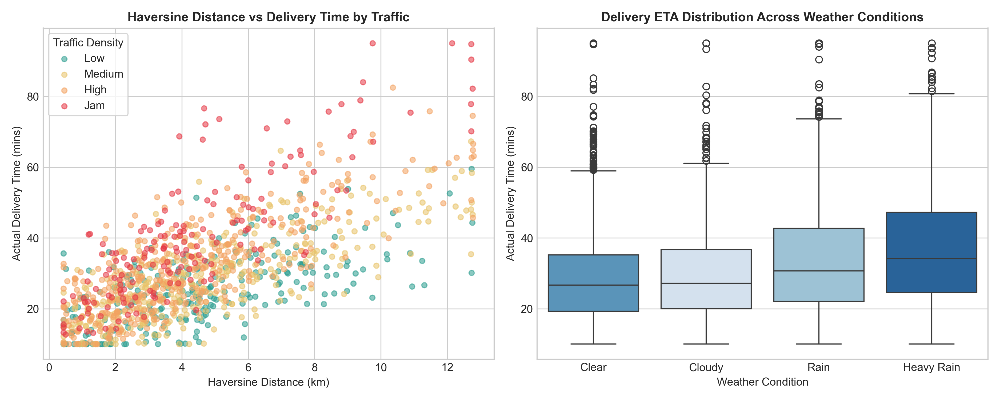
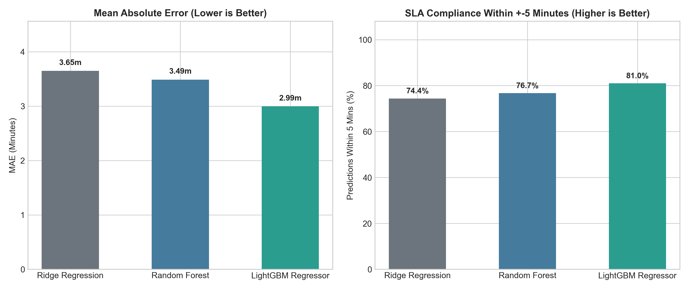
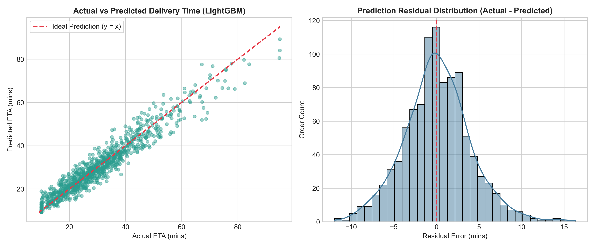
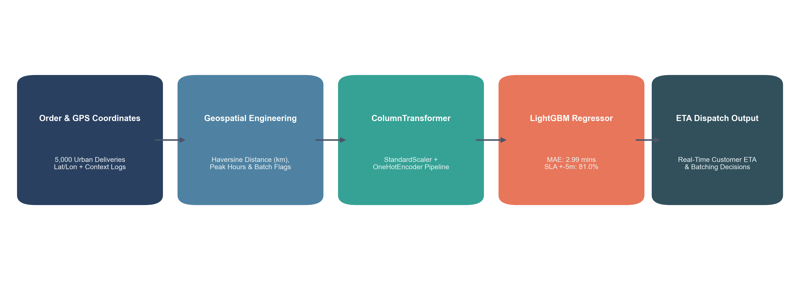
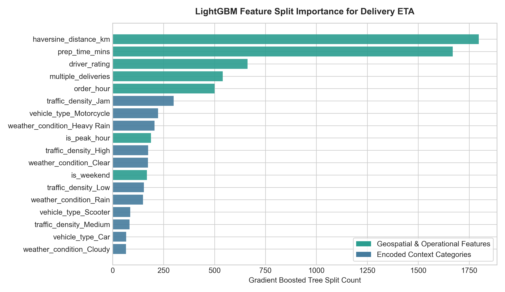

# Last-Mile Delivery ETA Prediction

Estimating last-mile food and parcel delivery times from Haversine geospatial coordinates, traffic congestion levels, weather severity, kitchen preparation time, and multi-order batching.

---

## Why Distance Alone Misses Urban Delivery Delays

Estimating food or parcel arrival with an average city speed breaks down as soon as a courier hits mealtime rush or rain. On this 5,000-order urban delivery log (mean arrival time 30.52 minutes), a 6 km trip finishes near 25 minutes in light traffic, yet routinely stretches past 45 to 60 minutes during gridlock.

  

To capture trip length before feeding context into any regressor, great-circle distance is computed directly from pickup and drop-off WGS84 coordinates $(\phi, \lambda)$ using the Haversine formula with Earth's mean radius $R = 6371\text{ km}$:

$$d = 2 R \arcsin\left(\sqrt{\sin^2\left(\frac{\phi_2 - \phi_1}{2}\right) + \cos(\phi_1)\cos(\phi_2)\sin^2\left(\frac{\lambda_2 - \lambda_1}{2}\right)}\right)$$

Weather shifts delays in two ways at once: heavy rain lowers travel velocity directly while also pushing more trips into congested road conditions, stretching the upper quartile of delivery times.

## Model Comparison: Linear vs Tree Ensembles

Three regressors were trained on an identical 80/20 split using the same `ColumnTransformer` preprocessing (standardized numeric features and one-hot encoded traffic, weather, and vehicle categories). Beyond MAE, RMSE, and $R^2$, each model is judged on operational SLA accuracy: how often the predicted ETA lands within $\pm 5$ minutes of actual drop-off.

| Model | MAE (mins) | RMSE (mins) | R2 | Within +-5 Min SLA |
| :--- | :---: | :---: | :---: | :---: |
| Ridge Regression | 3.648 | 4.783 | 0.8850 | 74.40% |
| Random Forest Regressor | 3.488 | 4.707 | 0.8887 | 76.70% |
| **LightGBM Regressor** | **2.994** | **3.924** | **0.9226** | **81.00%** |

  

Ridge Regression misses multiplicative speed penalties, such as cars losing far more speed in gridlock than motorcycles or scooters. LightGBM captures those interaction effects, trimming MAE by nearly 18% over the linear baseline (from 3.648 minutes down to 2.994 minutes) and lifting $\pm 5$-minute SLA compliance to 81.00%.

## How Traffic Congestion Drives Prediction Errors

Even with strong overall calibration, errors do not stay flat across every road state. On the 1,000 holdout orders, LightGBM residual spread stays centered near zero overall, but prediction uncertainty widens on longer trips past 50 minutes where traffic lights, parking, and building handoff delays add unavoidable variance.

  

Breaking holdout errors down by `traffic_density` highlights where dispatch buffers matter most:

| Traffic Density | Holdout Orders | Mean Actual ETA | LightGBM MAE | Within +-5 Min SLA |
| :--- | :---: | :---: | :---: | :---: |
| Low | 206 | 24.67 mins | 2.67 mins | 84.95% |
| Medium | 315 | 28.47 mins | 2.83 mins | 81.27% |
| High | 333 | 31.56 mins | 3.11 mins | 81.08% |
| Jam | 146 | 40.71 mins | 3.54 mins | 74.66% |

In `Low` traffic, nearly 85% of arrivals fall within 5 minutes of the predicted ETA. Under `Jam` conditions, mean arrival climbs to 40.71 minutes and SLA accuracy drops to 74.66%, signaling where customer-facing ETA ranges need wider confidence padding.

## Pipeline Flow & Feature Notes

  

Inside the LightGBM trees, trip distance (`haversine_distance_km`) and kitchen preparation lead time (`prep_time_mins`) account for the majority of splits. Concurrent multi-order batching (`multiple_deliveries`), courier rating, order hour, and severe congestion (`traffic_density_Jam`) supply the key adjustment signals around that baseline travel estimate.

  

Full 16-column dataset schema (5,000 orders)

 

| Feature Attribute | Data Type | Domain Description |
| :--- | :--- | :--- |
| order_id | Integer | Unique delivery order identifier |
| restaurant_lat | Float | Pickup merchant latitude in WGS84 degrees |
| restaurant_lon | Float | Pickup merchant longitude in WGS84 degrees |
| delivery_lat | Float | Customer drop-off latitude in WGS84 degrees |
| delivery_lon | Float | Customer drop-off longitude in WGS84 degrees |
| haversine_distance_km | Float | Great-circle distance between pickup and drop-off (km) |
| order_hour | Integer | Hour of order placement (0 to 23) |
| is_weekend | Binary | Weekend indicator (1 = Saturday or Sunday, 0 = Weekday) |
| is_peak_hour | Binary | Mealtime rush indicator for hours 11 to 13 and 18 to 20 |
| weather_condition | Categorical | Weather regime at dispatch (Clear, Cloudy, Rain, Heavy Rain) |
| traffic_density | Categorical | Road congestion level (Low, Medium, High, Jam) |
| vehicle_type | Categorical | Courier transport mode (Motorcycle, Scooter, Car) |
| driver_rating | Float | Historical courier reliability score (3.70 to 5.00) |
| prep_time_mins | Float | Merchant order preparation duration before pickup (minutes) |
| multiple_deliveries | Integer | Concurrent batched orders carried by the courier (0, 1, or 2) |
| delivery_time_mins | Float | Target total delivery duration from order to drop-off (minutes) |

## License

MIT: [LICENSE](LICENSE)
